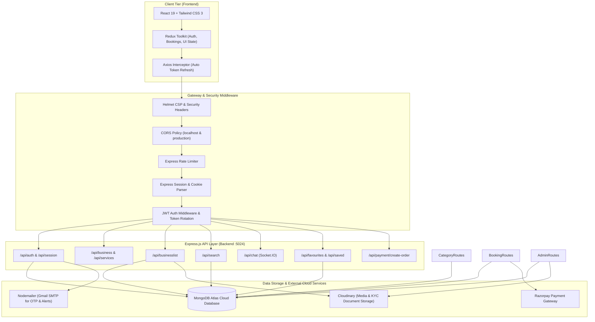
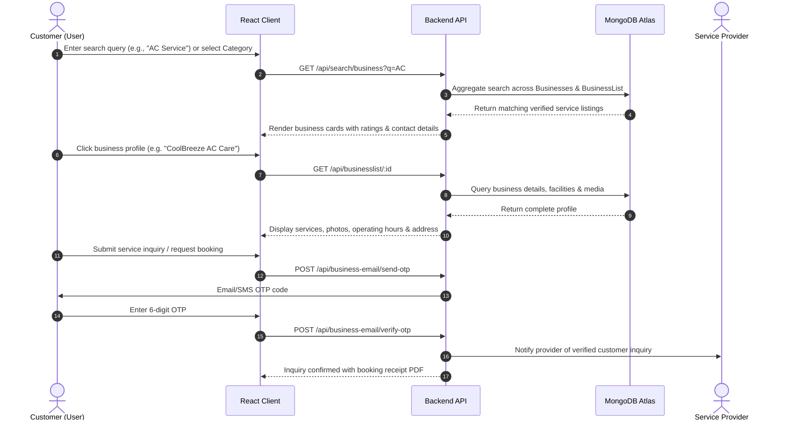
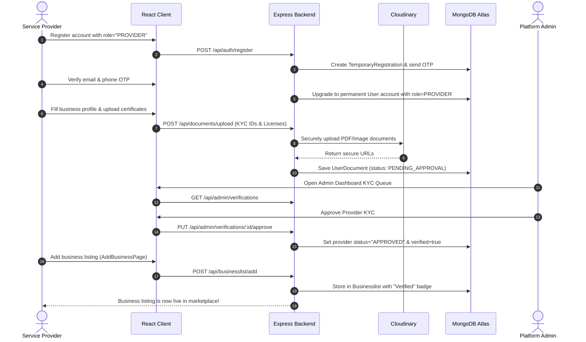
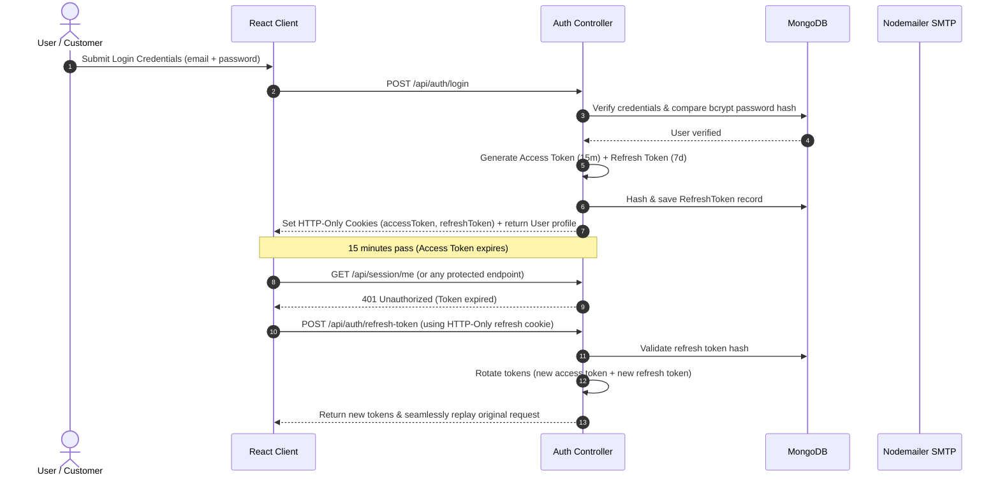

# Servizio — Multi-Vendor Local Service Provider Marketplace Platform

[](https://react.dev/)
[](https://nodejs.org/)
[](https://www.mongodb.com/)
[](https://tailwindcss.com/)
[](https://redux-toolkit.js.org/)
[](LICENSE)

**Servizio** is an enterprise-grade, full-stack multi-vendor local service discovery and booking marketplace platform (similar to Justdial and Urban Company). It seamlessly connects local customers with verified service providers across major industries including **Wedding & Event Requisites**, **Repairs & Home Services**, **Beauty & Wellness**, **Packers & Movers**, and **Daily Needs**.

---

## 📑 Table of Contents

- [Key Architecture & Features](#-key-architecture--features)
- [System Architecture Diagram](#-system-architecture-diagram)
- [Interactive Workflows](#-interactive-workflows)
  - [1. Customer Discovery & Booking Flow](#1-customer-discovery--booking-flow)
  - [2. Service Provider Onboarding Flow](#2-service-provider-onboarding-flow)
  - [3. Two-Step OTP & Token Security Flow](#3-two-step-otp--token-security-flow)
- [Core Service Verticals](#-core-service-verticals)
- [Database Schema & Collections](#-database-schema--collections)
- [Unified Monorepo Directory Structure](#-unified-monorepo-directory-structure)
- [API Reference](#-api-reference)
- [Getting Started & Local Setup](#-getting-started--local-setup)
- [Demo Credentials](#-demo-credentials)

---

## 🌟 Key Architecture & Features

### 1. Multi-Role Authentication & Security
- **Dual-Mode Authentication**: Seamlessly supports standard HTTP-Only cookie **JWT Access Tokens (15m)** with **Refresh Token Rotation (7d)**, as well as session-based cookie verification (`express-session`).
- **Two-Step OTP Registration**: Anti-spam account creation process (`TemporaryRegistration` ➔ Email OTP ➔ Phone OTP ➔ Permanent `User` account).
- **Four Distinct Role Tiers**: `USER` (Customer), `PROVIDER` (Service Provider / Business Owner), `ADMIN`, and `SUPER_ADMIN`.
- **Hardened Security**: Armed with `helmet` security headers, strict CORS configuration with credentials, and `express-rate-limit`.

### 2. Verified Service Business Directory (`Businesslist`)
- **Granular Categories**: Hierarchical multi-category system supporting dynamic subcategories matching industry requirements (`businessschema.js`).
- **Rich Business Profiles**: Verified badges, operating hours, geo-location addresses with pincode filtering, direct phone/email contact links, and interactive media galleries with Cloudinary storage.
- **Facility Badges & Price Ranges**: Filtering by facilities (`Air Conditioned`, `Valet Parking`, `Doorstep Service`, `24/7 Emergency Support`, `Certified Technicians`) and price tiers (`₹` to `₹₹₹₹`).

### 3. Customer Discovery & Search Engine
- **Real-Time Aggregated Search**: Multi-field regex indexing searching across business names, main categories, and subcategories simultaneously (`/api/search/business?q=...`).
- **Voice & City Search**: Instant city switching (Chennai, Bengaluru, Coimbatore, Madurai, Mumbai, etc.) with automated geolocation defaults.
- **Bookmarks & Favorites**: Persistent user wishlist and saved list functionality (`/api/favourites` and `/api/saved`).

### 4. Direct Inquiries & Messaging
- **Instant OTP Verification for Inquiries**: Fast SMS & Email OTP dispatch to verify customer authenticity before sharing contact information with service providers.
- **Real-Time Messaging**: Built-in direct chat pipeline between customers and service providers for price quotes, date checks, and customized requirements.

### 5. Admin Governance & Platform Auditing
- **KYC Document Queue**: Review and verify government identification proofs, address verifications, and business certificates.
- **Immutable Audit Logs**: Tracks critical system events (logins, role changes, business verifications, disputes) with IP addresses and timestamps (`AuditLog`).

---

## 🏛️ System Architecture Diagram



---

## 🔄 Interactive Workflows

### 1. Customer Discovery & Booking Flow



---

### 2. Service Provider Onboarding Flow



---

### 3. Two-Step OTP & Token Security Flow



---

## 🗂️ Core Service Verticals

| Vertical | Included Subcategories | Key Facilities & Features |
|---|---|---|
| **Wedding Requisites** | Banquet Halls, Bridal Makeup, Caterers, Wedding Photography, Wedding Planners, Decorators, DJs, Luxury Wedding Transport | Capacity filter (100–2,000 guests), AC mandapams, valet parking, drone shoots, multi-cuisine catering. |
| **Repairs & Services** | AC Jet Cleaning & Gas Refill, Electricians, Plumbers, Car Detailing & Garage, Bike Mechanics | 90-day service warranty, same-day doorstep arrival in 90 minutes, genuine manufacturer spare parts. |
| **Beauty & Spa** | Unisex Salons, Ladies Beauty Parlours, Therapeutic Ayurvedic Massages | Olaplex & L'Oréal certified stylists, hygienic steam sanitized environments, online slot booking. |
| **Daily Needs & Movers** | Packers & Movers, House Deep Cleaning, Pest Control, Grocery | 5-layer bubble packing, live GPS truck tracking, transit insurance, Taski eco-friendly cleaning chemicals. |

---

## 💾 Database Schema & Collections

```text
MongoDB: servizio
├── Businesses               # Main service categories & subcategory arrays
├── Businesslist             # Verified local business listings with contact, hours & media
├── services                 # Service catalog categories (mirrored for fast lookup)
├── servicelist              # Individual service packages & offerings
├── users                    # Unified user records (SuperAdmin, Admin, Provider, User)
├── providerprofiles         # Extended provider business KYC & address data
├── temporaryregistrations   # Transient registration records waiting for OTP completion
├── otps                     # Hashed 6-digit verification codes (10m TTL)
├── refreshtokens            # SHA-256 hashed refresh tokens with device & IP tracking
├── userdocuments            # KYC document records uploaded to Cloudinary
├── reviews                  # Customer ratings and verified reviews
├── auditlogs                # Immutable security & system transaction logs
├── guides                   # Consumer advice & service hiring guides
├── notifications            # In-app push notifications for bookings & inquiries
└── platformsettings         # Global commission rates, cancellation policies & flags
```

---

## 📂 Unified Monorepo Directory Structure

```text
Servizio/
├── backend/                              # Express.js Backend Server (:5024)
│   ├── config/                          # MongoDB Atlas & Cloudinary configurations
│   ├── controllers/                     # Business logic controllers (Auth, Business, Listings, etc.)
│   ├── middleware/                      # Auth guards, rate limiting, error handlers, file uploads
│   ├── models/                          # Mongoose schemas (Business, User, Service, etc.)
│   ├── routes/                          # Express REST API route definitions
│   ├── scripts/                         # Master database seeding scripts
│   │   └── seed_service_platform.js     # Master Service Provider Platform Seeder (Active)
│   ├── utils/                           # Nodemailer mailer, PDF generator, OTP generator
│   ├── validations/                     # Express-validator request sanitizers
│   ├── .env.example                     # Backend environment variable template
│   ├── package.json                     # Backend dependencies & scripts
│   └── server.js                        # Main Express entry point with dual /api and /api/v1 mounts
│
├── frontend/                             # React 19 + Vite Frontend Application (:5173)
│   ├── public/                          # Static assets, videos, icons
│   ├── src/
│   │   ├── api/                         # Axios instance with automatic token refresh interceptor
│   │   ├── AuthSections/                # Login, Register, Forget Password, OTP forms
│   │   ├── Components/                  # Reusable UI widgets, modals, badges, sidebars
│   │   ├── Config/                      # Business category schemas (businessschema.js)
│   │   ├── HomeSections/                # Landing page hero, category grids, service carousels
│   │   ├── JustDialHome/                # Service directory, category explorers, detail pages
│   │   │   └── ServicesPages/           # Add business, view subcategory listings, profile forms
│   │   ├── layouts/                     # Responsive Navbar and Footer layouts
│   │   ├── Pages/                       # User, Provider, and Admin dashboard views
│   │   ├── store/                       # Redux Toolkit store and feature slices
│   │   ├── App.jsx                      # Client router and session restoration
│   │   └── main.jsx                     # Application bootstrap
│   ├── .env.example                     # Frontend environment variable template
│   ├── package.json                     # Frontend dependencies
│   ├── tailwind.config.js               # Tailwind CSS theme configuration
│   └── vite.config.js                   # Vite build configuration
│
├── .gitignore                           # Comprehensive git ignore rules (Blocks all .env & node_modules)
├── docker-compose.yml                   # Multi-container orchestration (Backend + Frontend)
└── README.md                            # Complete Project Documentation
```

---

## 🔌 API Reference

### 1. Authentication & Session
| Method | Endpoint | Description |
|---|---|---|
| `POST` | `/api/auth/register` | Initiates 2-step registration & sends email OTP |
| `POST` | `/api/auth/verify-email` | Validates email OTP |
| `POST` | `/api/auth/verify-phone` | Validates phone OTP & creates permanent user |
| `POST` | `/api/auth/login` | Authenticates user (accepts email, username, or phone) |
| `POST` | `/api/auth/refresh-token` | Rotates expired access token using refresh cookie |
| `POST` | `/api/auth/logout` | Clears auth cookies and invalidates refresh token |
| `GET` | `/api/auth/me` | Returns active user profile from JWT |
| `GET` | `/api/session/me` | Hybrid endpoint checking either active Session or JWT |

### 2. Service Categories & Business Listings
| Method | Endpoint | Description |
|---|---|---|
| `GET` | `/api/business` | Fetches all service verticals and subcategories |
| `GET` | `/api/services` | Fetches local service listings |
| `GET` | `/api/businesslist/:id` | Fetches full business profile, media, hours & facilities |
| `POST` | `/api/businesslist/add` | Creates a new verified business listing |
| `GET` | `/api/search?q=:query` | Live keyword search across business names & services |
| `GET` | `/api/guides` | Returns consumer service hiring guides |
| `POST` | `/api/payment/create-order` | Initiates Razorpay payment order for bookings |

### 3. User Bookmarks & Interactions
| Method | Endpoint | Description |
|---|---|---|
| `POST` | `/api/favourites/add` | Adds a business to user favorites |
| `GET` | `/api/favourites/:userId` | Retrieves all favorite businesses for a user |
| `DELETE` | `/api/favourites/remove` | Removes a business from user favorites |
| `POST` | `/api/saved/add` | Bookmarks a service listing for later |
| `GET` | `/api/saved/:userId` | Retrieves all bookmarked listings for a user |

*(All endpoints are mounted on both `/api/...` and `/api/v1/...` for maximum compatibility).*

---

## 🚀 Getting Started & Local Setup

### Prerequisites
- [Node.js](https://nodejs.org/) (v18.0.0 or higher)
- [MongoDB Atlas](https://www.mongodb.com/atlas) connection URI (or local MongoDB on port 27017)
- [Git](https://git-scm.com/)

### Step 1: Clone the Repository
```bash
git clone https://github.com/muthukumar9360/Servizio.git
cd Servizio
```

### Step 2: Configure Environment Variables

**Backend Configuration:**
Create `backend/.env` using the template:
```bash
cp backend/.env.example backend/.env
```
Ensure your `backend/.env` contains your MongoDB Atlas connection string:
```ini
PORT=5024
NODE_ENV=development
MONGODB_URI=mongodb+srv://<username>:<password>@cluster0.uzsaneo.mongodb.net/servizio?retryWrites=true&w=majority
ACCESS_TOKEN_SECRET=servizio_master_access_secret_key_998877665544332211
ACCESS_TOKEN_EXPIRY=15m
REFRESH_TOKEN_SECRET=servizio_master_refresh_secret_key_112233445566778899
REFRESH_TOKEN_EXPIRY=7d
SESSION_SECRET=servizio_session_secret_key_12345
CLIENT_URL=http://localhost:5173
```

**Frontend Configuration:**
Create `frontend/.env` using the template:
```bash
cp frontend/.env.example frontend/.env
```
Ensure your `frontend/.env` contains:
```ini
VITE_SERVER_URL=http://localhost:5024/api
VITE_SERVER_MAIN_URL=http://localhost:5024
```

### Step 3: Install Dependencies
```bash
# Install backend dependencies
cd backend
npm install

# Install frontend dependencies
cd ../frontend
npm install
cd ..
```

### Step 4: Populate Master Database Seed Data
Populate the database with all service categories, verified business listings, customer guides, and working test accounts:
```bash
cd backend
node scripts/seed_service_platform.js
cd ..
```

### Step 5: Run Development Servers

**Option A — Running locally with Node:**

In Terminal 1 (Backend Server):
```bash
cd backend
npm run dev
# Server will start on http://localhost:5024
```

In Terminal 2 (Frontend Client):
```bash
cd frontend
npm run dev
# Client will open on http://localhost:5173
```

**Option B — Running with Docker Compose:**
```bash
docker-compose up --build
```

---

## 🔑 Demo Credentials

| Role | Email | Password | Access Level |
|---|---|---|---|
| **Super Admin** | `admin@example.com` | `SuperAdmin@123` | Full console, KYC document queue, business approvals, platform analytics |
| **Service Provider** | `provider@example.com` | `Provider@123` | Provider dashboard, add/edit business listings, upload KYC documents |
| **Customer / User** | `user@example.com` | `User@123` | Browse categories, submit inquiries, bookmark businesses, leave reviews |

---

## 📄 License
ISC License © 2026 Muthu Kumar — Built for Servizio Service Provider Platform.
